# A tour of the site

[← Back to the README](../README.md)

The screenshots come from the English demo league (see [Try it with demo data](../README.md#try-it-with-demo-data)), logged in as the demo driver Maya. The logged-in driver's name is highlighted in red wherever it appears.

- [Home](#home)
- [Races](#races)
- [Before a race](#before-a-race)
- [After a race](#after-a-race)
- [Logging a race round by round](#logging-a-race-round-by-round)
- [Standings](#standings)
- [Statistics](#statistics)
- [Drivers](#drivers)
- [Driver profiles](#driver-profiles)
- [News](#news)
- [Articles and comments](#articles-and-comments)
- [Activity and notifications](#activity-and-notifications)
- [Admin panel](#admin-panel)

## Home

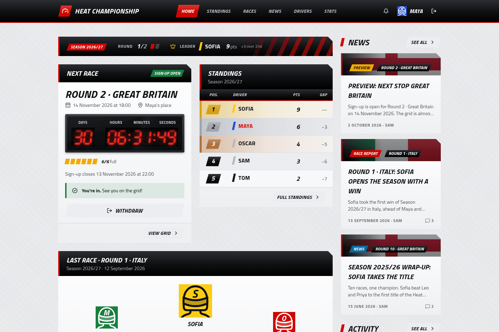

The front page answers "what's next?" at a glance:
- a bar with the current season, how many rounds have been raced and who's leading;
- the **next race**, with an LED countdown to the start, the seats taken and your own sign-up button;
- the top five of the **standings**;
- the podium of the **last race**;
- the latest **news** and **activity** down the side.

## Races

  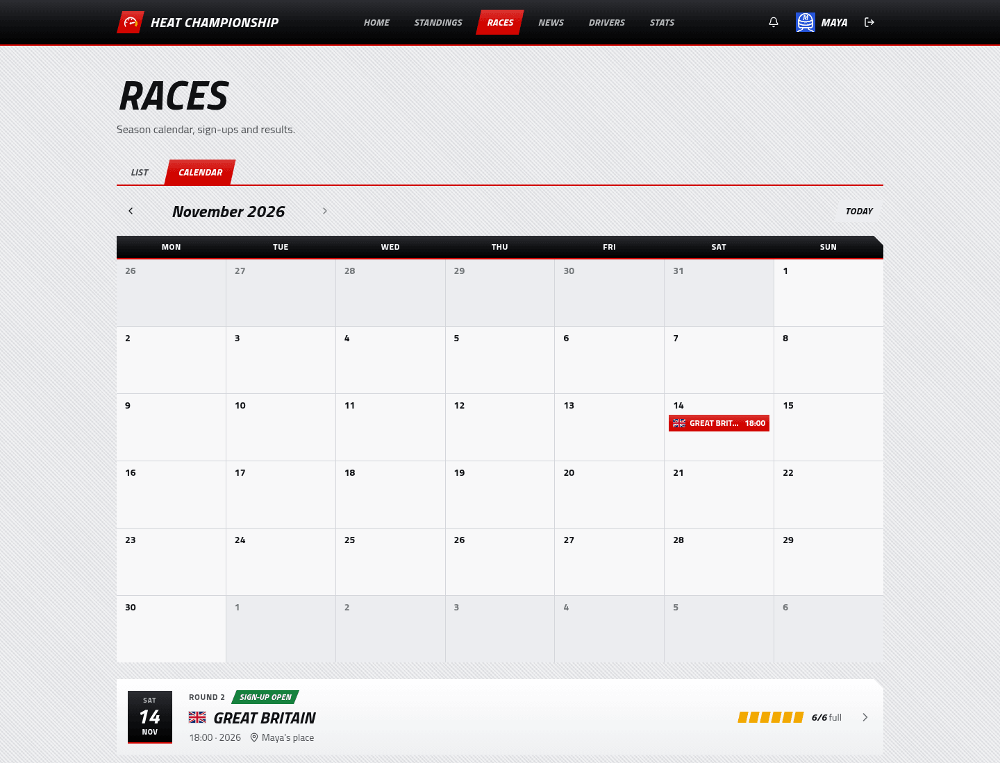
  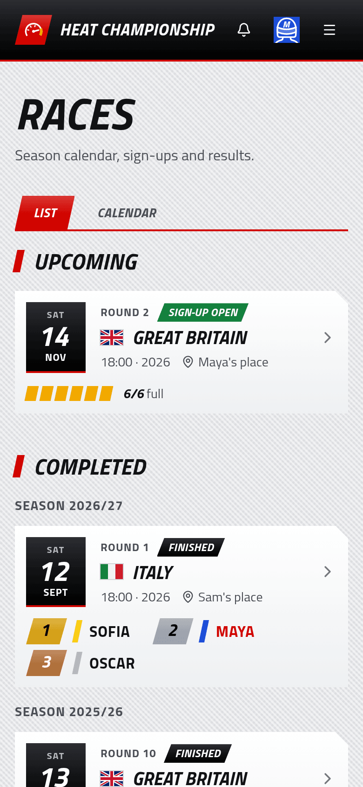

Every race of every season, as a **list** (upcoming first, then past races grouped by season, each with its podium) or as a **month calendar**. The whole site works on phones too, as the race list on the right shows.

## Before a race

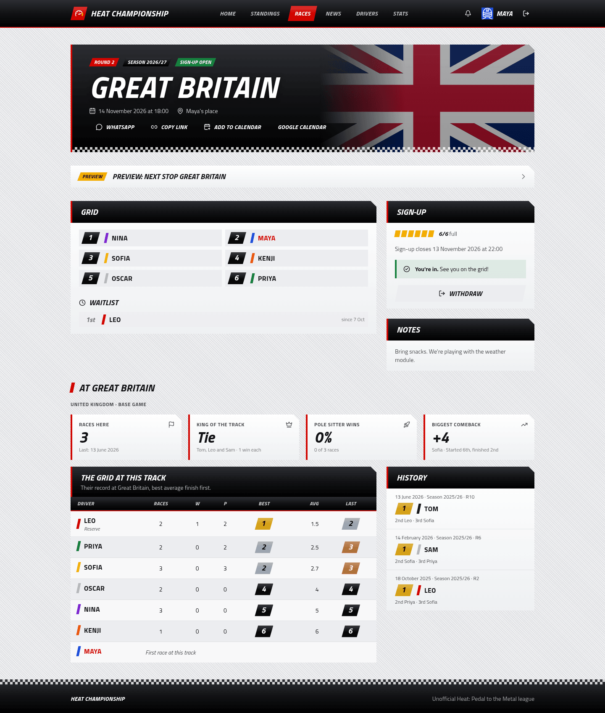

Each race has its own page, with the track's country flag in the banner. Before the race it's all about signing up:
- **The grid** shows who has a seat, plus the **waitlist**. Seats go in sign-up order. When the race is full, new players join the waitlist, and if someone withdraws the first person waiting moves up automatically.
- **Sign-up** shows how many seats are left and the deadline, with a button to join or withdraw. Players can withdraw until the race starts; signing up again puts you at the back of the queue.
- **Sharing:** a WhatsApp message (with the date, place and seats left), a copy-link button, a calendar invite with a reminder 2 hours before, and a Google Calendar link. Shared links show a preview image with the track, flag and sign-up status.
- **At this track:** the track's history in the championship. It shows how many races were held there, who has won it most, how often the driver starting first wins, the biggest comeback, each entrant's record there and the latest podiums.

## After a race

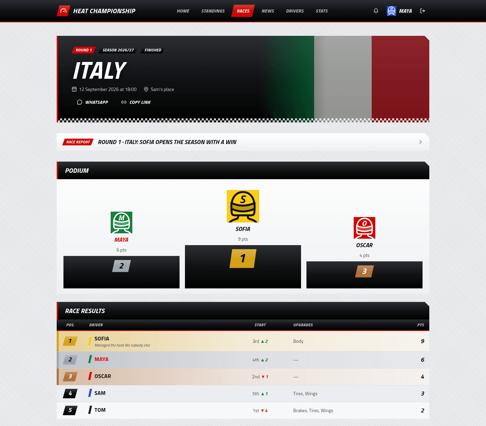

Once the organiser enters the results, the page switches to the **podium** and the **full results**: finishing and starting position (with places gained or lost), the upgrade cards each driver used, spins and notes. Upcoming races show each confirmed driver's **chances** of a win and a podium, worked out for fun from recent form and history at that track. Until a race starts, anyone in the league can **predict the podium** (3 points per exact place, 1 for a podium driver in another place). Picks stay private until the start; afterwards the race page lists them with their points, the standings page keeps a season **Oracle** table, and badges go to an exact podium call and the season's best predictor. For a week after the results, the race's drivers vote for the **Driver of the Day** (not themselves); the tally stays hidden until voting closes, and the winner gets a badge. It also lists the **achievements unlocked** in that race, and the race's drivers can upload **photos** of the final board.

## Logging a race round by round

During the race the organiser can log it from a phone with **Log race** (a button on the race page, for admins). It only needs the end of each round:
- **Starting grid:** the confirmed drivers, ordered with arrows or a random draw, each with a car colour (their favourite one by default).
- **Each round:** the map zooms in on the car whose turn it is and lights up the spaces it can reach; tap where it finished, in turn order. The spot within a space, the turn order and the running order are worked out from the positions. Slipstreams and spins are one tap after placing the car, and the odd spin-out that lands out of order can be swapped.
- **Saving** happens after every change, with a copy on the phone in case there's no signal.
- When everyone has crossed the line, **Go to results** opens the results sheet already filled in (positions, grid, spins and colours).

Once a round is closed, the race page shows a **round by round** section: the **moment of the race** (the biggest climb up the order in a single round) and the **rivalry of the race** (the pair that swapped places most often), an animated replay on the track map, a lap chart, a **corners** heat map (passes on each stretch of track, with spins and slipstreams per corner), per-driver numbers (overtakes, slipstreams, spins, average and best move, rounds led) a **video** of the replay, recorded in the browser and ready to share on WhatsApp from a phone, and downloads as **JSON** (a self-describing document, handy for writing the race report) or **CSV**. For now only the USA track has a map; the others need their card traced into `src/lib/race-log/`.

## Standings

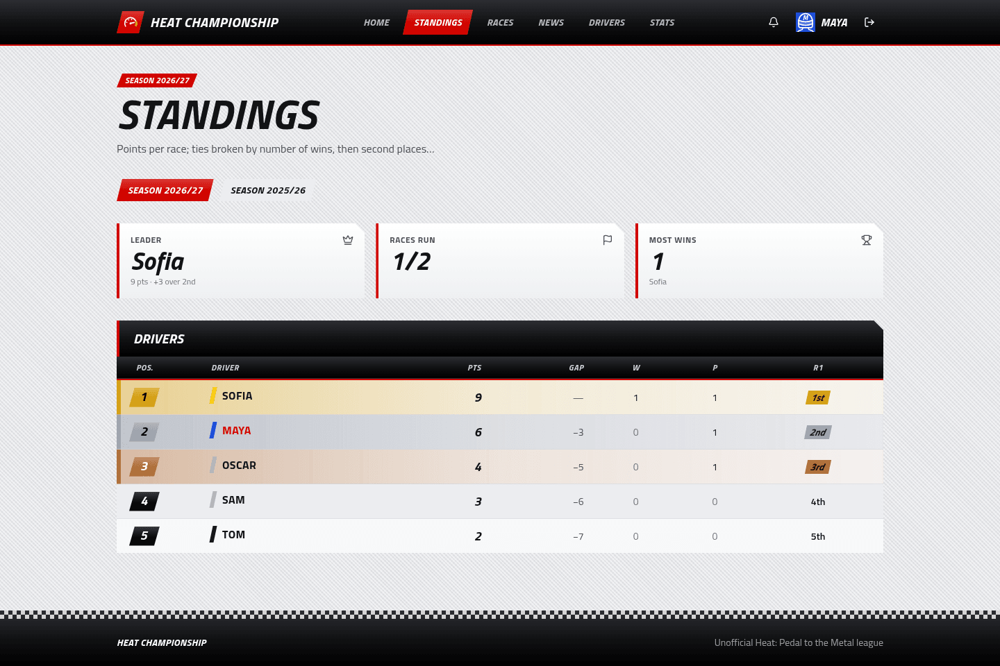

The championship table: points, gap to the leader, wins, podiums and each round's result. Ties are broken by countback (most wins, then most second places, and so on), and arrows show who moved up or down since the previous race. Once a season has two or more races, a chart shows how the points built up round by round. While a season is running, a **title fight** card shows the points still up for grabs, who can still be champion and what the leader needs at the next race to seal it. Past seasons are one click away.

## Statistics

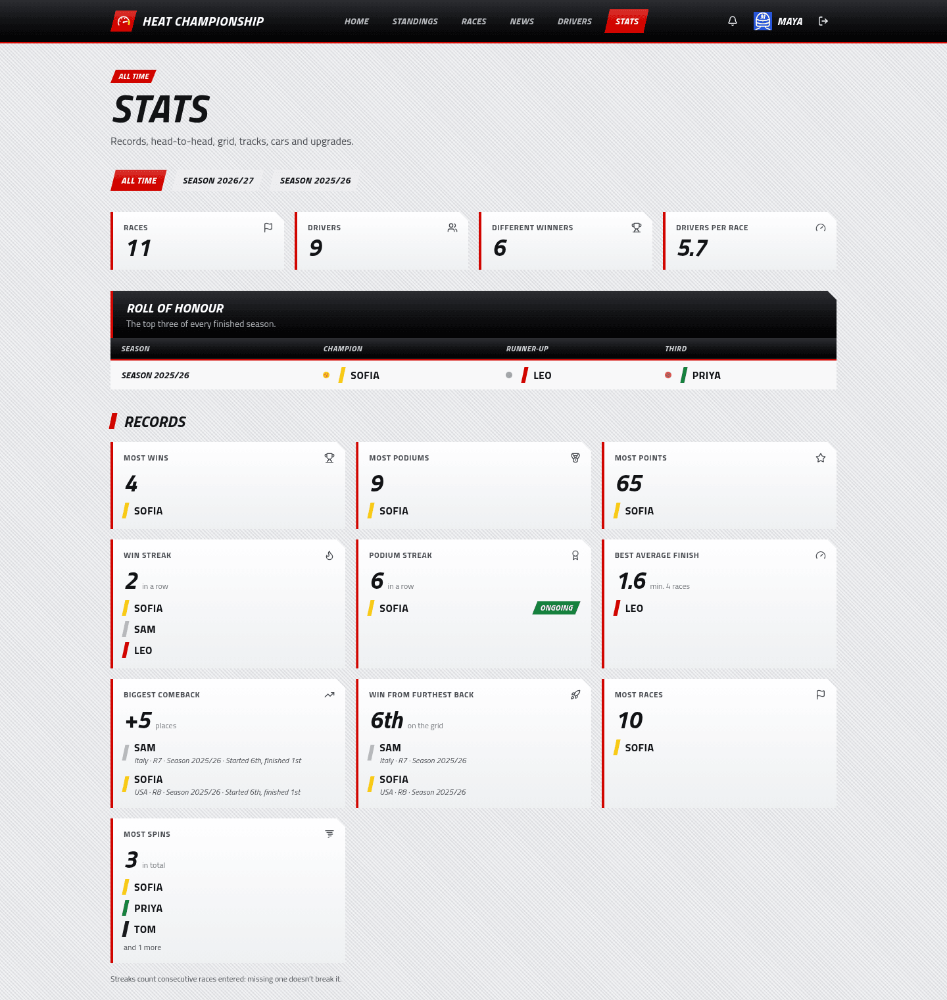

Numbers for the whole championship or a single season:
- the **roll of honour**, with the top three of every finished season;
- **records**: most wins, podiums and points, win and podium streaks, best average finish, biggest comeback, win from furthest back, most spins. Streaks count consecutive races a driver took part in, so missing a month doesn't break one;
- a table comparing every driver;
- a **head-to-head** grid: how often each driver finished ahead of each other, and how many times they swapped places in races logged round by round;
- the **win rate by starting position**;
- per-track winners, and results by car colour and by upgrade card.

## Drivers

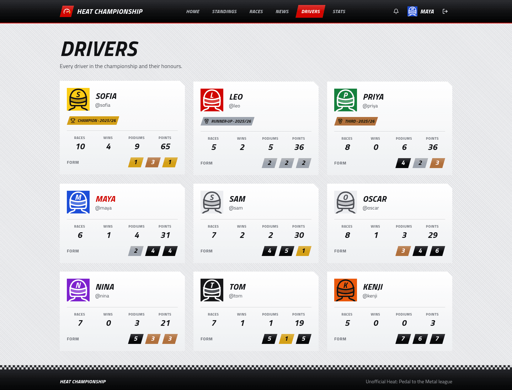

Every driver in the championship, most points first. Each card shows their season trophies, career numbers and recent form.

## Driver profiles

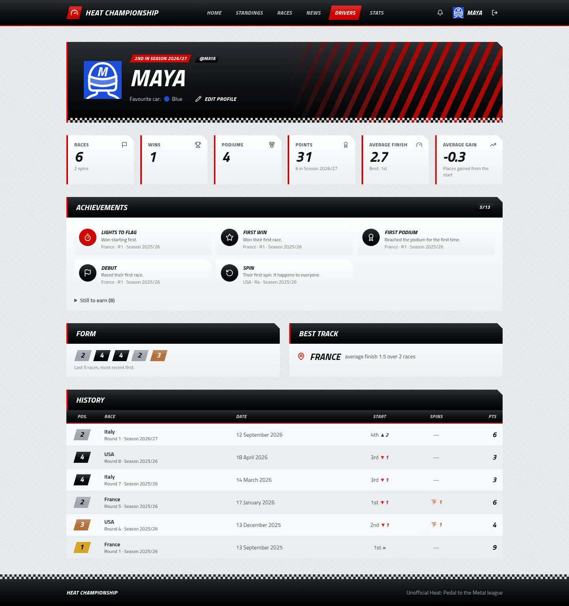

A driver's own page: career stats, **achievements**, recent form, best track and full race history. Players edit their own name, photo, bio, favourite car colour and password from "My profile". Each driver also has a **season in review** page, Wrapped style: their numbers, best day, biggest comeback, nemesis and favourite victim, favourite car and track, spins, slipstreams, Driver of the Day awards, prediction points and the badges earned that season.

Achievements are worked out from the results, so nothing is entered by hand. When a season finishes, its top three get the **Champion**, **Runner-up** and **Third** trophies. Badges cover things like winning from last on the grid, gaining 4 or more places, three wins in a row, five podiums in a row, winning at three different tracks, racing every race of a season or reaching the podium after a spin. Races logged round by round add a few more: leading every round, winning by passing the leader in the final round, and the season's most slipstreams. Badges not earned yet are listed under "Still to earn". The definitions and thresholds are in [`src/lib/achievements.ts`](../src/lib/achievements.ts).

## News

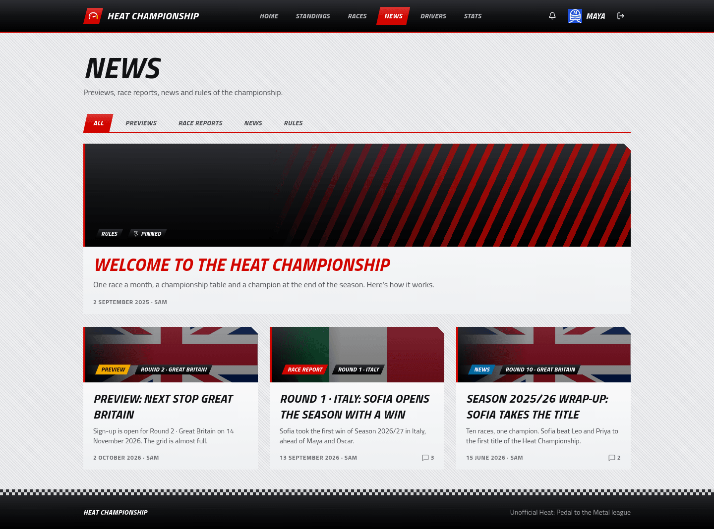

Articles from the organiser, filtered by category: **previews**, **race reports**, **news** and **rules**. An article can be pinned to the top. When it belongs to a race, it uses that race's flag as its banner (unless it has its own cover image) and is also linked from the race page.

## Articles and comments

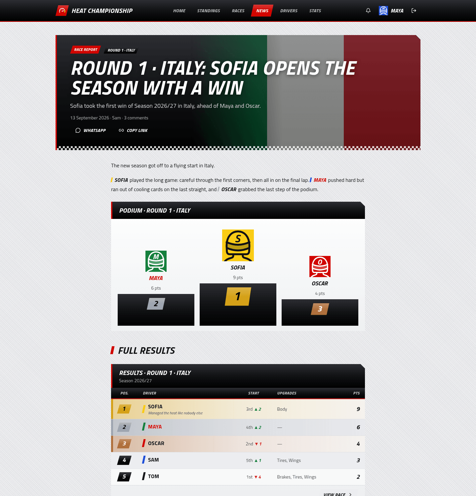

Articles are written in Markdown, and two things make them more than plain text:
- **Mentions:** `@username` links to the driver's profile (with their car colour) and notifies them.
- **Live blocks:** a race card (countdown and sign-up before the race, podium after), a results table, a podium, the standings after a race, the current standings or a driver card. They always show current data, so a preview written before the race shows the podium once it's over. The editor inserts them from the toolbar; in the text they look like `{{podio:<race id> | Round 1 · Italy}}`.

Logged-in players can **comment**, reply and mention each other.

## Activity and notifications

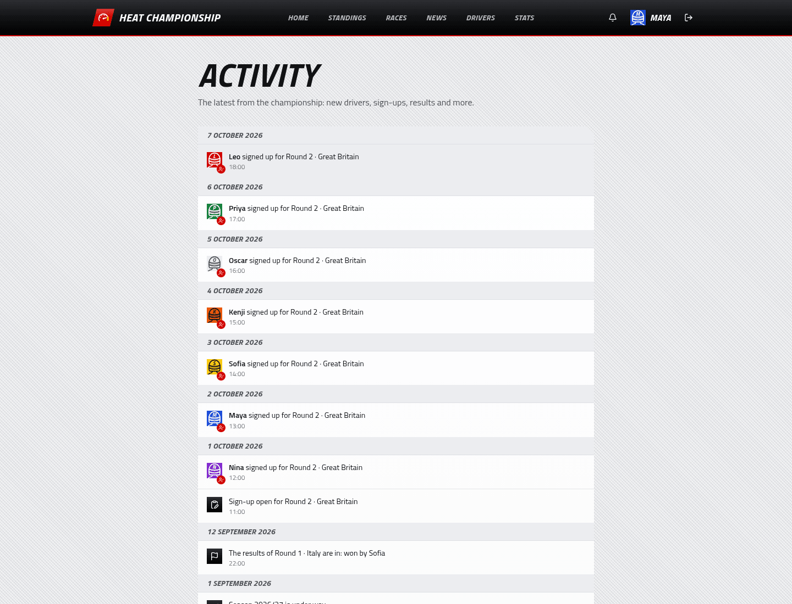

The **activity feed** follows the life of the league: new drivers, races announced, sign-up opening, sign-ups and withdrawals, results, photos, and seasons starting and finishing. The latest entries also appear on the home page.

The **bell** in the header is personal: it tells you when someone mentions you, replies to your comment, or the results of a race you drove in are published.

## Admin panel

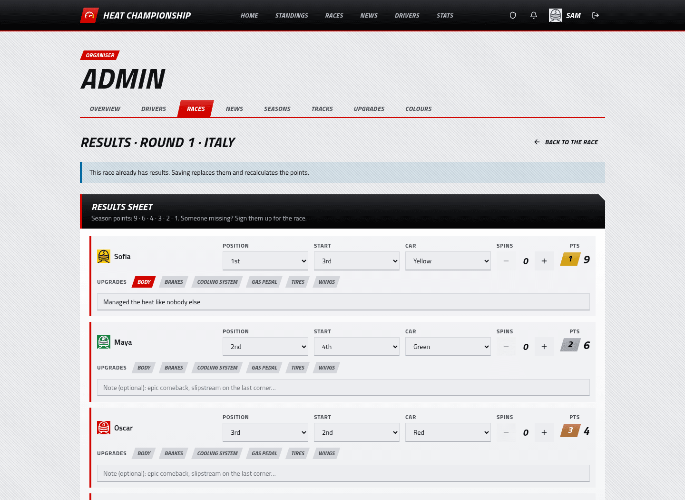

The organiser runs everything from **`/admin`** (shield icon in the header):

| Section | |
|---|---|
| **Overview** | Open or close registration for new players. |
| **Drivers** | Rename players, reset forgotten passwords (it can generate an easy one to read out), give or remove the admin role. |
| **Races** | Create a race with its season, track, date, place, seats and optional sign-up deadline. *Draft* hides it, *Sign-up open* lets players join, *Sign-up closed* stops new sign-ups. You can also add or remove drivers yourself, even when sign-up is closed. |
| **News** | Write articles with a toolbar, drag-and-drop images and a live preview. |
| **Seasons** | Seasons and their points table. Only one season can be in progress at a time. Changing the points table re-scores that season's finished races. |
| **Tracks / Upgrades / Colours** | The catalogues: tracks (with country flag and default laps), upgrade cards and car colours. Anything already used can be deactivated but not deleted. |

**Entering results** (screenshot above): after the race, open it in admin and click **Results**. For each driver pick the finishing position (everyone finishes in Heat), starting position, car, upgrade cards and number of spins, plus an optional note. Points are previewed live from the season's table. Saving awards the points, marks the race finished and notifies the drivers. You can edit or void the results later.
